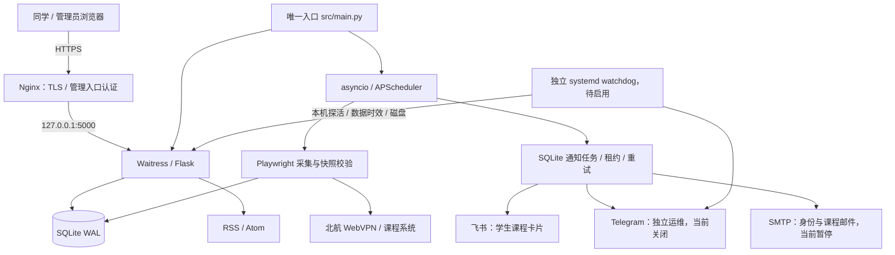

# 系统架构

更新时间：2026-10-25。本文说明当前组件和维护边界；生产版本、通道开关和观察窗口以 [项目状态](../project/PROJECT_STATUS.md) 为准。

下一版采集设计已形成：[观察、调度与补位通知方案](SCRAPE_DESIGN.md)、[交互导览](scrape-design.html)、[ADR 0009](../decisions/0009-observation-driven-scraping.md)。这些为待实现规格；下文继续描述当前代码。

## 业务目标与拓扑

帮助同学查课、筛选，并在发现新课、开选或真实退选释放名额时收到课程提醒。报名由同学在官方系统完成，运维异常单独发送给管理员。

`src/main.py` 是唯一应用进程入口，加载配置、安全检查和数据库后，在线程中运行 Waitress，在事件循环中启动调度器并先做一次完整采集。SQLite、调度器、浏览器与全局缓冲仍属于单实例模型，不能直接增加 WSGI 多进程或复制 systemd 服务扩容。

## 模块职责与依赖方向

| 层次 | 模块 | 职责与边界 |
| --- | --- | --- |
| 领域规则 | `course_state.py`、`time_utils.py`、`scrape_outcome.py` | 课程状态、签到、时钟和采集结果；不依赖数据库、Web、浏览器和渠道 |
| 数据 | `models.py`、`notification_jobs.py` | 模型、兼容迁移、短事务、幂等键、领取/租约/退避；不反向调用调度器、抓取器或 Web |
| 采集 | `auth.py`、`scraper.py`、`staging_fixtures.py` | 登录、DOM/网络解析、分页完整性、字段合并和入库；通过结果契约交给调度器 |
| 筛选与文件服务 | `filters.py`、`qrcode_service.py` | 全局筛选、二维码验证/存储与公开数据整形 |
| 渠道 | `push/feishu_bot.py`、`push/ops_bot.py`、`push/email_push.py`、`push/telegram_bot.py`、`push/rss_feed.py` | 模板、固定端点传输和投递结果；不反向调用调度器/抓取器或 Web |
| 编排 | `scheduler.py` | 单次采集互斥、浏览器生命周期、缓存、事件识别、任务投递与生命周期同步 |
| 接口 | `web/app.py`、`web/security.py`、`web/qrcode_feature.py` | 请求验证、会话、管理员边界、序列化、页面和服务适配 |
| 进程与隔离 | `main.py`、`runtime.py` | 启动、日志、安全配置；预发布在导入资源前验证隔离 |
| 维护 | `scripts/`、`.github/workflows/`、`deploy/` | 验证、部署、主机检查与目录维护；维护工具不导入应用来做盘点 |

`web/app.py` 仍调用调度器公开入口，这是当前编排边界。模型/outbox 和推送实现还持有查询、模板与传输细节；`ops_bot.py` 暂复用飞书模块的禁止重定向类，是后续可提取的共享传输职责。大文件拆分按一个职责一批推进，保留 URL、响应字段、事务与事件语义。

`scripts/check_repository.py` 用 AST 检查上述核心依赖方向，也检查函数内导入。发布验证及 CI 均调用它；它不是完整架构证明，不覆盖动态导入或所有循环依赖。

## 采集与课程状态

1. 调度器按普通周期、活跃报名窗口和热门监控触发 full/quick；同一采集流程互斥。
2. Playwright 复用进程内上下文，失效时重新登录；创建失败清理 driver，持续失败退避。
3. DOM 与网络结果补充解析。分页用全部可见表的完整摘要、首页/末页核对和有界等待，拒绝循环、跳页失败、异常空页、失去登录、页数上限和已声明总数不符。
4. 原始记录稳定去重；最新完整容量/已选人数替代旧名额，空详情不擦掉已有字段。签到只按 `check_in_method` 识别，不能由“自主选课”推断签到。
5. 结构化结果区分有课、无课、认证失败、上游失败、解析失败和超时；可疑稀疏快照及失败不覆盖可靠数据库。
6. 新课、开选和真实满额到有名额事件按全局筛选进入飞书任务；页面展示各课观测时间，陈旧名额标记待核对，发送前再次校验时效。

`course_state.py` 是报名窗口、过期、热门、剩余名额和签到标签的共同规则来源。Web、筛选、邮件、调度、RSS 与二维码复用它；列表 SQL 为效率下推的条件需要与之保持一致并由回归保护。

已核对的生产分页证据见 [学生卡片与采集覆盖验收](../project/SCRAPE_CARDS_RELEASE_2026_10_24.md)。上游未提供独立总数时，只能报告已遍历页数、唯一记录数与端点校验，不能宣称已数学证明绝无遗漏。

## 通知策略与任务

| 通道 | 服务谁 | 当前策略 |
| --- | --- | --- |
| 飞书 `feishu` | 同学 | 新课、预告/开选、真实退选补位；只用课程卡片，不承接运维 |
| Telegram `telegram_ops` | 管理员 | 独立开关、异常/恢复、冷却和目标隔离；待服务器联网启用 |
| SMTP `email` | 邮箱用户 | 身份邮件与业务邮件分别授权；当前总开关关闭 |
| 旧 Telegram 课程通道 | 历史课程功能 | 数据库开关关闭，不因运维启用而改变 |
| RSS/Atom | 公开订阅读者 | 由 `rss_enabled` 控制，无外部主动投递 |

通知任务经过 `pending → processing → succeeded/failed`，带幂等键、租约和有限指数退避；成功记录不重置。预告与开选区分身份，补位包含实际观测事件，升级兼容旧成功记录以减少重推。陈旧或已恢复的运维任务按渠道规则跳过。

任务处理由调度器按 job_type 分派。SMTP/HTTP 阻塞调用移出事件循环，处理期间续租。外部服务已接受、数据库尚未记成功时崩溃仍可能重投，因此只能承诺至少一次语义。接口 code=0 或 Telegram ok=true 也不能替代群内人工可见确认。

独立 `check_ops_health.py` 及 systemd timer 能在主进程异常时检查本机健康、采集时效和磁盘；整机/网络失联仍需外部监控，当前没有由此获得跨主机保障。

## 身份、二维码和数据库

邮箱链接 GET 只展示确认页，POST 才消费一次性 challenge；验证码和 challenge 保存摘要，限次且过期。门户只信任已验证/活跃用户的 HttpOnly、SameSite Cookie。邮件恢复前需真实指定邮箱验收，详见 [运行手册](../operations/RUNBOOK.md)。管理员接口同时受应用层和 Nginx 边界保护。

二维码上传从门户会话解析身份，校验大小、真实图片类型、尺寸和 SHA-256，随机命名后进入待审核。公开列表和文件只提供审核通过、仍 active 且课程有效的记录；不公开邮箱、原名或服务器路径。

SQLite 使用 WAL、busy_timeout 和有限重试，各请求/任务创建短生命周期 Session。`init_db()` 先建表再增量补字段/索引；保留旧数据和字段。业务时区默认 Asia/Shanghai，数据库兼容 naive datetime，外部 RSS/Atom 转 UTC。业务代码通过统一时钟取时间。

## 运行与维护

生产目录、配置优先级和回退操作分别见 [目录约定](../project/PROJECT_LAYOUT.md)、[配置](../development/CONFIGURATION.md)、[部署](../operations/DEPLOYMENT.md)。维护工具、文档与控制工作流可以先进入仓库；生产应用提交和实际进程需要单独记录。

公开端点使用短时缓存，静态资源使用版本参数；数据库查询下推筛选并使用组合索引。容量判断需要实际资源与查询数据，不以健康检查推断长期性能。

目录维护默认只盘点，按清单分别处理七天前的独立诊断捕获，或状态根目录十分钟前的指定配置回退副本；保留摘要和恢复记录，复核应用提交与 PID。真实 `.env`、数据库、上传、依赖和浏览器按各自生命周期管理；详见 [目录维护手册](../operations/DIRECTORY_MAINTENANCE.md)。
