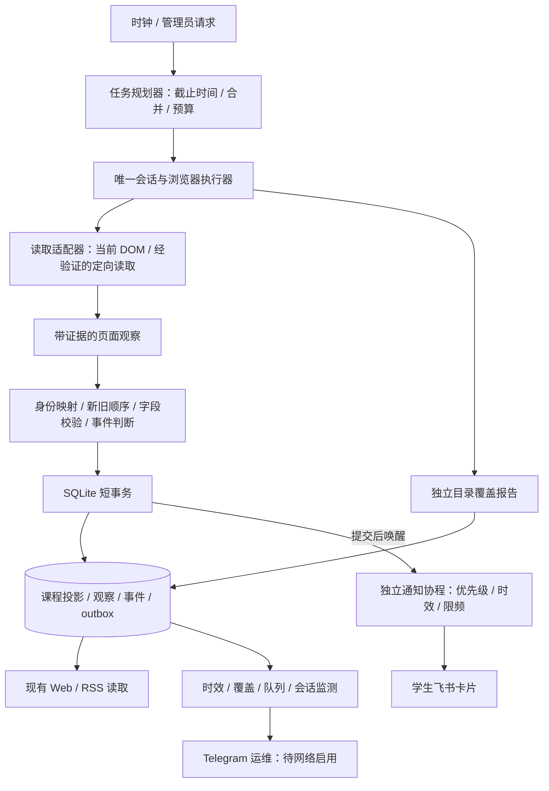

# 课程采集与补位通知架构设计

日期：2026-10-25。状态：P1 基础能力已部署，主体观察/事件引擎尚未迁移或部署。对应决定见 [ADR 0009](../decisions/0009-observation-driven-scraping.md)，开发顺序见 [实施与验收计划](../project/SCRAPE_IMPLEMENTATION_PLAN.md)，交互图见 [设计导览](scrape-design.html)。

本文定义下一版的目标行为。当前运行实现仍以 [ARCHITECTURE.md](ARCHITECTURE.md) 和 [项目状态](../project/PROJECT_STATUS.md) 为准；表中周期、阈值和接口扩展均为待验证的候选设计。

P1 已开始落实身份分页、分级恢复和阶段计时，实际代码、两次修复与现场状态见 [P1 执行记录](../project/SCRAPE_P1_2026_10_25.md)。这部分实现不代表下文页级入库、原子事件和时效目标已经达到。

## 1. 服务任务与成功条件

系统帮助同学发现符合群筛选的新课、掌握开选时间、发现重新释放的名额，并进入官方系统报名。飞书承载课程，Telegram 承载运维；Telegram 待联网、邮件暂停、自动选课冻结的决定继续有效。

优先次序：不产生错误补位和误过期 → 尽快交付可靠名额观察 → 不漏掉已提交的业务事件 → 补齐课程说明 → 核对完整目录。名单覆盖和热点响应都要测量，不能用提高某一任务频率牺牲另一任务后仍宣称整体达标。

设计必须满足：

1. 名额不会等待详情抓取或后续历史页才进入状态库。
2. 单页可靠观察可以推进该课；未完成的目录遍历不能证明其他课已下架。
3. 课程状态、业务事件、待发送任务同事务落库；提交之后进程退出不漏事件。
4. 每个名额值携带真正的观测时间和来源；写库时间不能代替观测时间。
5. 翻页、会话、传输、解析、业务筛选的故障分开处理。
6. 单进程、一个 Playwright driver 和一个浏览器；页面状态由唯一执行器持有。Flask、SQLite、现有 URL 和课程 ID 保持兼容。

## 2. 已确认的基线与证据边界

| 证据 | 结论 | 限制 |
| --- | --- | --- |
| 生产应用 `04fc2086c487`；[诊断 40163646740](https://github.com/2725238326/boya-agent/actions/runs/40163646740) | 样本中 12:18:55 开始 quick，12:19:31 完整覆盖 7 页/131 条；下一次覆盖为 12:21:48，相隔 137 秒 | 有界日志样本，不能计算全天成功率或 P95 |
| 同窗口有重复页、重建浏览器和可疑空快照拦截 | 成功采集与失败重试交替，旧数据保护工作 | 尚未证明生产每次重复页的根因相同 |
| 本地真实 Chromium 固定样例复现 | 末页课程身份不变、人数变化时，现有全表文本摘要可能判为前进；随后重复身份检查拒绝整轮 | 证明代码缺陷；不是生产触发条件的唯一解释 |
| `scraper.py` 的 quick/full 共用 `_collect_current_view_courses` | quick 仍完整翻页，详情补抓在循环内；上限按每页传入 | 无法从 15 秒触发间隔推导 15 秒数据更新 |
| `scheduler.py`、`notification_jobs.py` | 已有 outbox；缓冲、事件发现与课程提交之间仍有内存/跨事务窗口 | 发送任务持久化不等于事件产生全过程已持久化 |
| 生产约 2 GiB 内存；浏览器/应用同机 | 必须先约束重复导航、重试和页面数 | 不能以扩大浏览器并发代替时效设计 |

其他风险包括：无活跃课程时主要靠普通周期发现新课；高频触发忙时跳过；旧数据统一按整轮写库时刻更新 last_seen；提前超过一天的新课可能只进入已关闭的每日摘要；热点判断用最新一门课的时间可能掩盖其他热点陈旧。

## 3. 目标组件与依赖



| 组件 | 输入 → 输出 | 不持有 |
| --- | --- | --- |
| 任务规划器 | 意图、各课到期时间、上游能力/预算 → 有界读取命令 | Page、登录票据、通知模板 |
| 执行器 | 读取命令 → 观察与执行证据 | Web 请求会话、筛选决定 |
| 读取适配器 | 同一登录身份下的只读页面/响应 → 标准观察 | 发送行为、过期其他课程的权限 |
| 状态服务 | 观察 → 课程更新、事件、发送资格与任务 | 浏览器和外部网络 |
| 通知协程 | 已提交任务 → 接受/跳过/失败结果 | Page、课程采集锁 |
| 运行统计 | 时间、计数、结果 → 管理摘要/运维事件 | Cookie、响应全文、用户身份 |

建议模块逐步提取到 `src/collection/{contracts,planner,session,providers,pagination}.py`、`src/observations/{service,repository,events}.py`。`src/scheduler.py` 保留启动和旧 API 适配，`src/scraper.py` 保留现有兼容入口；不在第一批移动全部大文件。新领域契约不导入 ORM/Web/Playwright，通知不反向调用抓取器。

## 4. 上游能力先验证

当前可确认入口是带登录的 DOM 列表，已有网络响应记录器只是补充解析。不能假定存在可直接读取的公开 JSON、单课接口、稳定游标或允许扩大轮询频率。

| 能力档位 | 启用证据 | 执行策略 | 可承诺范围 |
| --- | --- | --- | --- |
| `browser_catalog` | 当前可读取列表 | 一个持续目录遍历同时满足发现/名额观察；按页交付，不重复跑三套全量循环 | 以实际遍历周期报告逐课时效；初始目标见第 12 节 |
| `browser_scoped` | 筛选/页面定位可验证，返回课程身份与目标一致 | 活跃课程所在页/范围优先，其余目录分时完成 | 可验证的定向名额目标 |
| `session_read` | 同一授权会话的只读请求可正常解码、字段/分页/权限一致，且完成线上小范围比较 | 经执行器统一限流读取；保留 DOM 回退 | 容量足够时启用更严格时效目标 |

能力记录包含 source、身份域、证据版本、稳定 source_id、分页身份、独立总数、排序/范围及响应绑定是否可靠；默认未知即不可用。响应必须绑定当前请求、课程和会话代次，不能把旧标签页/旧请求的迟到结果当最新状态。

还须证明“刷新”真正取得新响应：刷新失败后重新解析旧 DOM 不得推进 seat_observed_at。若上游只是前端对旧载荷分页，一次遍历各页沿用该载荷的获取时间；有经过验证的 source_generated_at、缓存 Age/版本时一起保存。本地读取时间只能证明何时观察，无法保证上游内部没有缓存，这一限制单独报告。

身份域始终是本系统服务账号可见范围；群筛选不保证每位同学都有报名资格。禁止改变登录身份、绕过认证、自动选课或为得到接口而执行报名写请求。真实响应和凭据不进入设计样例或 Git。

## 5. 调度：独立意图，共享读取

### 5.1 四种意图

| 意图 | 候选到期规则 | 工作量与完成定义 |
| --- | --- | --- |
| 名额观察 | 活跃/已满候补约 20 秒，已开选非热点约 60 秒；按每课年龄调度 | 只读取身份、窗口、容量、已选和必要状态，绝不补介绍 |
| 新课发现 | 无活跃课程仍每 60–90 秒计划发现；能力受限时复用目录循环 | 排序/增量范围未经证明时必须覆盖全目录，不能只刷首页 |
| 完整核对 | 约 10 分钟完成一次目录审计 | 记录页序列、覆盖质量、总数与范围；可与发现共享同一遍历 |
| 详情补全 | 新课或筛选必要字段优先；其余 TTL/内容变更到期 | 每次一课、有界重试；过期历史课程不占用补抓预算 |

“到期”表示需要执行，不表示已经完成。不同意图命中同一读取范围时合并一次读取，分别完成各自的意图；观察成功不能冒充目录完整成功。full 请求撞到 quick 时记录仍待完成的核对意图，已有名额观察不抹掉它。

### 5.2 单执行器与公平性

浏览器操作串行；仅在一页/一次响应完成的安全点切换任务，不在点击、返回或登录中途让另一个协程操作 Page。最多两个固定用途页面：列表页、详情页；详情页每次结束复核状态，页面数与内存均有上限。登录全局 single-flight，切换会话代次会使旧命令与响应失效。

队列按到期程度、补位/开选优先级和等待年龄选任务。不能永远只服务最新一门热点；按每课年龄调度，老任务提升优先级。发现/核对保留预算；超载时先停止非必要详情，再拉长普通巡检，并明确暴露逾期。Web 手动刷新合并意图，不创建额外循环、不绕过限流。

重启从 SQLite 读取未完成意图、到期状态和最近成功覆盖；采用短租约，过期执行意图可重新领取。同范围意图有唯一键，任务数有界，过期意图合并为最新需求，不积累几千次历史 tick。

### 5.3 容量与候选预算

先测量每种读取的 P50/P95、逻辑列表请求数和有效观测间隔。候选初始上限为同一上游每分钟 12 次逻辑列表/名额读取、突发 1；登录和详情另有全局串行预算，全部 HTTP 请求仍计数观察。现场若已有更低限制则从更低值开始；429/维护信号立即尊重 Retry-After 并降速。

`最短可行循环 ≥ 所需独立读取的总服务时间`，还受上游限流和保留给其他意图的预算约束。若名额需遍历全部 7 页，发现与名额复用这一遍历，不能再叠加另一个 7 页扫描。超过容量时不得靠无限重试维持“20 秒”配置假象。

候选页面命令 8–12 秒预算、详情单次最多 10 秒、目录审计累计 120 秒；登录可独立占用最多 60 秒并标注恢复状态。这些值需 P1/P2 实测后配置。硬超时后清理对应命令和 Page 状态，不能让失控协程继续操作浏览器；整个作业无上限等待不可接受。

## 6. 观察、覆盖与更新契约

### 6.1 标准观察

以下均为新设计字段。标有“未知”的值不能被当作 0 或未开选：

| 字段 | 语义 |
| --- | --- |
| `observation_id` | 本次实际读取的唯一 ID；同批重试提交复用，重新读取必须新建 |
| `run_id / page_sequence / acquisition_sequence` | 作业、页序列、单执行器递增读取序列，便于审计与排序 |
| `engine_generation / session_epoch / source / scope` | 引擎切换代次、会话代次、适配器、可见范围 |
| `course_id / source_key` | 兼容系统 ID 与经验证的上游身份映射 |
| `observed_at / received_at / committed_at` | 实际读取、结果收到、事务提交；新审计表用带时区 UTC |
| `capacity / enrolled / window` | 同一可信读取的完整名额对与报名窗口；字段可明确未知 |
| `identity_digest / value_digest` | 身份摘要用于分页；值摘要用于字段变化，不互相替代 |
| `quality / eligibility_fields` | 字段有效性、上下文绑定和筛选字段是否齐全 |

业务旧表继续兼容 Asia/Shanghai naive 时间，新契约跨层统一显式时区转换。耗时和截止使用 monotonic；检测到系统时钟异常或会话代次不匹配时降级，不用墙上时钟倒退决定“新结果覆盖旧结果”。读取序列持久化，与 session_epoch/执行器启动代次组合，跨重启不从零误排。

不能仅因读取了课程名称，就更新名额时间；详情读取也不能延长名额有效期。名额与详情各有版本和时钟。来自请求响应与 DOM 的观察按照实际获取顺序/来源一致性判定；不再简单认为“最后合并的数组项永远最新”。

### 6.2 身份与质量

优先使用经验证的上游不可变 ID；保留既有 course_id 和网页直达链接，映射表增量添加。当前 ID 包含地点、教师等可能变更字段，字段修正不能直接生成“新课”群推；同名并行场次也不能盲目合并。有冲突的映射进入待核对，保留原记录与证据，禁止发补位。

单课写入要求：身份明确、范围与响应绑定正确、字段可解析、时间无矛盾、名额成对且非负。容量未知时 remaining 为未知，不能显示为 0 或触发满额转补位；已选大于容量时记录异常并禁止可报名事件。窗口未知不发“已开选补位”。

### 6.3 正向观察与目录证据分开

一页通过上下文和字段校验后，已确认课程可单独更新；随后另一页失败不撤销这些正向观察。行级解析失败标记该页 incomplete，失败/模糊身份行不入库；若上下文不可信则整页隔离。

目录报告独立记录 `verified`（有独立范围/总数等证据）、`endpoint_checked`（无独立总数，仅端点/页序列验证）、`incomplete`。真实上游没有总数时保持 endpoint_checked，不标记数学意义完整。一次读取可有部分有效观察和不完整覆盖，不能用一个 success 布尔同时表示二者。

verified 还要求同一稳定范围/快照版本或经验证的一致游标；仅“唯一记录数等于总数”不能证明滚动变化的分页无遗漏。没有这种快照条件时，即使有可读总数也保留 endpoint_checked 并记录数量核对结果。

任何缺页、重复、范围变化或上游异常，都不能据此清空、批量过期未出现课程。时间已明确结束可按生命周期过期；长期未见先标陈旧/待核对，隐藏策略与删除是独立动作，需可靠范围证据和多轮确认。旧的“最近全站成功即可解释所有缺席”规则不再扩展。

## 7. 分页与可恢复扫描

1. 先捕获当前请求范围、页码/游标（若有）、课程身份集合与对应读请求证据，再点击只读分页控件。
2. 有页码/游标时等待其变化及目标页完成；没有时，依据身份变化结合请求/加载完成判定，人数变化仅更新值，不能证明翻页。
3. 旧分页在末页保持下一页可点时，独立末页控件复核；若身份仍相同但值改变，作为同页新观察，确认边界后结束，不伪造下一页。
4. 身份相同也可能是两页完全重复或请求卡住。无法确认边界则标 incomplete；同页可局部重读一次，禁止将“不变”一律当末页。
5. 翻页后抓到的身份与目标范围不符、跨页集合异常重叠或排序变化时保留证据，限制恢复次数。纯名额变化不导致目录审计重启。
6. 每页交付后保存 checkpoint。恢复时必须复核会话、筛选、游标/身份；DOM 页码不是稳定快照，不能将旧“第 4 页”直接当未变化的数据边界。
7. 同一浏览器 Page 的位置发生变化时，在安全点重新定位并验证；无法验证的扫描结束为 incomplete，下一轮重开。已提交单课观察仍保留。

页面空状态须绑定已完成的本次请求、正确课程路由和有效会话；空 DOM 占位或只有 networkidle 不是证据。空目录与已有有效课程冲突时进入复核，旧数据保留并标陈旧。结构发生变化时保留受控捕获，不反复登录掩盖解析问题。

## 8. 状态、事件与原子提交

### 8.1 报名状态与新鲜度是两个维度

报名状态为 `unknown / upcoming / open_full / open_available / closed`；新鲜度单独为 `fresh / aging / stale / unknown`。一门课可以处于 open_available 但名额 stale，此时页面显示“上次有名额，待核对”，不显示为当前可抢。

旧观察乱序到达仅进入审计，不回写较新字段；重复 observation_id 不重复更新或发事件。每次有效完整名额对增加 seat_version。`last_seen` 保留兼容，新增 `seat_observed_at / detail_observed_at` 明确分工。

### 8.2 事件规则

| 触发 | 事件与用户文字 | 限制 |
| --- | --- | --- |
| 首次确认一门合格课 | `course_discovered`，“新课预告/课程信息” | 每群每课一次；未齐筛选字段时持久化等待补全 |
| 预告课进入开选时间 | `enrollment_opened`，“已开选” | 先触发一次新鲜名额读取；时钟到点本身不证明有名额 |
| 新鲜满额 → 新鲜可报名，容量不变且已选下降 | `availability_reopened`，“退选补位” | 前后观察间隔候选 ≤120 秒；来源一致，窗口明确 |
| 满额 → 可报名且容量增加，或原因无法唯一确定 | `availability_reopened`，“新增名额/重新有名额” | 卡片不能一律称为有人退选 |
| 旧满额快照隔了很久后看到余量 | `availability_available`，“当前有名额” | 不称刚刚退选；按群可报名策略去重 |
| 同一可报名阶段内 1 → 2 → 1 | 不产生新补位事件 | 最新值仍入库；新的满额 → 可报名才增加 availability_episode |
| 窗口结束、再次满额、事件被更新版本否定 | 取消待发送资格 | 记录原因，不能伪装成功送达 |

事件包含前后观察、seat_version、availability_episode、原因与规则版本。相同余量在后续新 episode 中可以再通知；第一次启动只有 available 不能造出一次“退选”。未知字段后被详情补齐时重新评估未过期资格，不依赖课程再次变成“新 ID”。

event_id 使用不透明 ID，数据库唯一键为课+event_type+business_key：发现键固定该课，开选键固定已确认报名窗口，放额键为窗口+availability_episode。持续 available 或 stale→available 而没有新鲜满额证据时，不凭空增加 episode。开选时间被修正先更新持久意图；只有确认新报名窗口才建立新阶段，不能因文案/地点修改重复发开选消息。

### 8.3 事务边界

```text
对一页可靠观察开始短事务（事务中无 await、浏览器或外部网络）
  校验 observation_id 去重、身份、会话代次与新旧顺序
  记录观察；读取并更新课程投影/seat_version
  由旧状态与新状态推导事件；唯一约束防重
  按当前群策略写发送资格与到期时间
  满足条件则在同一 Session 创建 outbox，不在此处 commit
提交事务
  唤醒通知协程；丢失唤醒由定时扫描补救
```

现有 enqueue_notification_job 已接受调用方 Session 并 flush，可复用，移除上层分散提交。观察事务在受限数据库工作线程中执行，Session 不跨线程；遇锁等待有界，异步层退避，不长时间阻塞事件循环。任何异常整页写入回滚；同 observation_id 可安全重提。

开选等未来意图也持久化；到期后资格评估与 outbox 创建在一个事务里完成。缺详情的等待意图有 TTL、原因与重试时间；关闭通道只记录当时策略，不在以后启用时追发全部历史事件。

## 9. 数据模型、容量与兼容迁移

| 新增结构/字段 | 核心内容与索引 |
| --- | --- |
| `collection_runs` | 意图、能力档位、起止、结果、coverage_grade、页数/唯一数、独立总数可空、checkpoint/错误类型；索引时间与结果 |
| `collection_intents` | 范围唯一键、优先级、due_at、deadline、租约、合并计数；索引状态/到期 |
| `collection_control` | 单行保存有效引擎与 generation、切换水位；事务检查代次，拒绝已停用执行器的迟到提交 |
| `course_observations` | observation_id、课/来源/时钟/序列、名额对/摘要/有效性；唯一 observation_id+课，索引课+观测时间 |
| `course_events` | 不透明 event_id、课/类型/episode、前后观察、规则版本、原因；唯一课+事件类型+业务阶段/episode |
| `course_notification_intents` | 事件、目标哈希、策略版本、资格状态、not_before、expires_at、跳过原因；唯一目标+事件+阶段 |
| `course_identity_aliases` | source+scope+source_key 到既有 course_id，冲突不能自动覆盖 |
| `courses` 增量字段 | seat_observed_at、detail_observed_at、seat_version、availability_episode、最后读取序列/代次、可空来源标识 |
| `notification_jobs` 兼容扩展 | 现有状态/租约/重试继续；新 job_type 为 `course_event_v2`，payload 仅 event_id、target 哈希与版本；可空 outcome 区分 accepted/skipped/expired |

旧时间、pushed、课程 ID 与 URL 均保留。索引/字段采用增量幂等迁移，旧代码继续能读取旧列。历史 last_seen 不能倒填为“刚验证”的 seat_observed_at，新名额时钟在首次 v2 可靠读取后建立。

存储先记录全部名额变化与事件锚点；不变名额按课每五分钟最多一条审计心跳，课投影时钟仍随有效观察更新。短期无变化观察候选保留 7 天，事件锚点及相关观察候选 30 天，运行聚合 30 天；先在线统计增长并验证备份，再独立清理。示例：20 门课每五分钟心跳约 5760 行/天，不是每秒永久写一份全文。全文页面/响应不入观察表，诊断捕获独立受控。

## 10. 通知交付与学生体验

通知协程在事务提交后由 asyncio.Event 唤醒，同时候选每 5 秒扫描到期任务。补位优先于开选与新课；同课更新不会导致旧事件插队发送。飞书仍按至少 1.1 秒间隔、固定 HTTPS host、禁止重定向、签名和限体积执行；单次超时有界，租约独立续期。

| 事件 | 候选时效与发送条件 |
| --- | --- |
| 退选/重新放额 | 观察年龄 ≤45 秒、事件年龄 ≤90 秒；窗口有效、剩余 >0、未被更新 episode/满额否定 |
| 正式开选 | 到点后的可靠观察年龄 ≤60 秒；每课每群该阶段一次 |
| 新课预告 | 不再依赖 daily_summary_enabled；发现后即建立持久资格，候选 ≤180 秒送出，必要详情到齐后再评估 |
| 介绍更新/普通人数变化 | 网页更新，不刷课程群 |

发送前只复核数据库最新状态和时效，不在发送函数内抓网页。陈旧时由规划器安排验证读取，任务等待到 TTL；过期则明确 skipped/expired，不能拿 10 分钟旧数据发补位。入队到实际发送间再次满额时跳过；传输在途后名额改变仍存在客观竞态，卡片保留准确观测时间与“以官方实时名额为准”。

预告的 180 秒是交付目标，不是三分钟后抹掉新课资格：已知报名窗口时预告资格截止于开选，开选阶段由独立意图处理；窗口未知时候选上限为发现后 24 小时，并在窗口补齐时重算。目标超时记录违约，不能删除失败样本；课程明确结束或被过滤才终止对应资格。

缺失自主签到等群必需条件时暂不发送，界面显示待确认；优先安排一次详情补全并持久重试，不能把暂时失败永久加入 attempted_ids。普通介绍不会阻塞名额更新；必要字段未确认时宁可延迟群推并记录原因。

相同可报名 episode 的多次失败重试合并，过期补位不补发；事件投递结果与用户可见卡片分类一致。outbox 保持外部至少一次语义：服务已接受后、成功落库前崩溃仍可能重复；不承诺 exactly-once。记录 accepted、skipped、expired、failed 分开计数，接口接受不能等同人已看到。

## 11. 故障恢复与降级

| 故障 | 首个处理 | 升级与降级 |
| --- | --- | --- |
| 人数变化但身份未变 | 接受同页值观察，按端点/请求证据确认边界 | 无证据则 incomplete，保留状态；不重新登录 |
| 翻页卡住/渲染延迟 | 有界等待并局部重读一次，记录命令 deadline | 放弃该次覆盖，后续重开；其他课已提交观察保留 |
| 详情超时/没有字段 | 单课重试退避与 TTL | 暂停该课必要资格；不阻塞其他名额 |
| 明确 SSO 失效/登录页 | 单一登录恢复，令旧会话代次失效 | 失败指数退避 30→60→…→600 秒并加抖动，期间不反复创建 driver |
| 浏览器/driver 已断开 | 清理后重建一次 | 连续失败熔断；维持 1 driver 上限并报告时效下降 |
| 429/维护/上游 5xx | 尊重 Retry-After，减少总读取预算 | 按依赖冷却；不靠多浏览器绕过限制 |
| SQLite 锁/磁盘问题 | 短事务重试，任务身份可重放 | 不先提交课程再“稍后补事件”；写失败只上报内存安全摘要 |
| 飞书失败/限频 | 独立 outbox 退避，发前每次检查 TTL | 不影响采集；事件过期停止重发 |
| 重启/取消 | 过期租约重新领取；确认已提交观察与事件 | 冷启动不把当前 available 当补位，保留旧成功去重 |

浏览器软回收改为基于年龄/资源/健康的安全点计划；不以几轮高频采集就强制重复登录。回收有硬资源上限，不能为热点无限推迟。能否保留会话不作承诺，不把校园登录票据持久化到仓库。

## 12. 时效、可观测性与验收目标

### 12.1 度量口径

- `seat_age`：当前时间减该课最后一次有效名额 observed_at；对**全部应监控课程**统计，没读到或启动前的未知值计超标，不能从分母删除。
- `observation_gap`：同课相邻有效观测间隔；失败、冷却和调度饿死都会自然放大。
- `ingest_lag`：committed_at-observed_at；`dispatch_lag`：供应商接受时刻-事件提交时刻。
- `discovery_age / catalog_audit_age`：最近完成相应范围发现/核对的年龄，按覆盖档位分别统计。
- `event_to_accept`：实际观察到变化至供应商接受的时间。上游真实发生时间通常未知，不能称为“真实退选到送达延迟”；后者仅能用有真值的 fixture 测试。
- 所有分位数连同窗口、样本量、成功/失败/过期计数报告；只统计成功发送会掩盖漏发和过期。

seat_age 每 15 秒对全部应监控课程取样，按热点/普通课/能力档位报告；不能只在读取成功时取样或让高频读到的课占满分母。请求发起时分配读取序列，迟到响应沿用原序列；没有可信源版本时不能用晚收到来宣称源数据更新。

### 12.2 候选目标（尚未达到）

| 项目 | 候选准入条件 |
| --- | --- |
| 状态提交 | P95 ingest_lag ≤2 秒；详情和后续页面不能增加它 |
| 队列响应 | 无积压且供应商可用时，P95 提交至开始投递 ≤3 秒；5 秒扫描为唤醒丢失的补救 |
| 已观测补位交付 | P95 observation→accepted ≤10 秒；过期/跳过/失败单列，不能被剔除美化 |
| 有定向能力的活跃课 | P95 seat_age ≤45 秒、P99 ≤90 秒；超载降级计入可用性 |
| 仅 DOM 全目录能力 | 初始目标 P95 seat_age ≤120 秒；仍需证明扫描实际负载可行，未达标不启用秒级产品承诺 |
| 新课发现 | fixture 中真实出现→有效发现 P95 ≤180 秒；生产报告已覆盖范围的发现间隔，上游真值未知 |
| 完整核对 | 业务可见范围 10 分钟内更新一次报告；endpoint_checked 与 verified 分开 |
| 数据与事件 | 故障注入下误过期 0、旧观察回写 0、提交后漏建事件/outbox 0；外部重复窗口单独记录 |

运行前先采集基线，固定样例至少 1000 次有真值变化；生产观察至少 72 小时并覆盖一个真实开选窗口，无真实窗口则该项待验收。72 小时达标也不代表整个学期稳定；后续按 7 日窗口继续统计。

### 12.3 API 与界面

保留 `/healthz` 的公开最小探活语义；不能因上游短暂失败就让进程健康端点失败、触发无效重启。管理员 `/api/status` 增加 collection 摘要：能力档位、最后有效观察/目录核对、每课最大年龄与分位数、到期/逾期意图、会话状态和分类型错误，不返回原响应或登录信息。

`/api/courses` 保留现有字段，增量提供 `seat_observed_at / detail_observed_at / seat_age_seconds / availability_freshness`。source 保留 last_success、refreshing、degraded，另加有边界的观察/覆盖时间，不把一个全站时间当逐课新鲜度。API 缓存、Flask 缓存和前端轮询也计入显示延迟：活跃名额缓存候选 ≤3 秒，页面可见时每 10–15 秒拉公开数据、隐藏时退避，不让每位访问者触发上游抓取。

兼容字段 last_success 仍代表最近完成一次可信范围任务，新增 last_observation_at 单列局部成功；不能悄悄改成任一页面成功。degraded 的目标判定由应监控课程年龄、发现/核对逾期与依赖状态共同决定，一个页面成功不能清除其他课程的持续陈旧；具体映射随 API 实现批次和前端一起测试。

不默认增加公开 metrics 端点；内部聚合从受保护管理状态与结构化日志读取。运维按 service/source/discovery/outbox/disk 分类去重，区分采集冷却和服务停止。当前 Telegram 网络未通，设计/本地告警演练不算生产通知能力已启用。

## 13. 配置、迁移与回退

候选配置分为 engine 模式 `legacy / observe / active`、能力档位、总请求预算、意图周期、命令 deadline、事件 TTL 和审计保留。全部由统一配置对象解析，拒绝无效组合；数据库 interval_minutes 与启动 env 的优先级必须统一。管理员只调允许的业务周期，不可绕过总预算。

上线顺序与每批验收见 [实施计划](../project/SCRAPE_IMPLEMENTATION_PLAN.md)。observe 阶段只旁观当前合法读取并写隔离评估记录，不新增生产遍历、不改业务课程、不创建外部任务；只有一个引擎拥有浏览器。实际切换时先备份/幂等迁移，首次观察建立 baseline，导入既有成功消息阶段去重，随后才允许 v2 产生事件。

`course_event_v2` 由明确新处理器领取；旧处理器 job_types 白名单不得误领。回退切回 legacy、停 v2 任务生产与领取、保留新增表和 outbox，不删除业务数据；旧缓冲不跨引擎重放。再次启用 v2 时沿用事件/episode，过期任务记录过期，不重发历史当前课。

本轮新事件类型仅接入已授权的飞书课程通道。切换前核对旧待发任务：仍有效的先完成或明确标为被替代，按目标/课/阶段建立迁移锚点；不能让旧任务与新事件各发一次。回退时新任务仍保留但旧版本不能误领，后续按 TTL 处理。

切换先提升持久 engine_generation，再停止旧命令。每个写事务复核有效引擎和 generation；即使旧线程在取消后才返回，也不能在切回 legacy 后继续提交 v2 状态或创建群推。内存开关和取消 Task 本身不足以隔离迟到工作。通知领取同样检查活动模式，新请求关闭后不再发起，已在途请求按实际结果记录。

每批必须明确实现状态、应用 SHA、数据/配置影响和实际业务观察。本文不能作为已发布功能说明；产品、API 和配置主文档只在对应实现批次更新当前行为。

## 14. 备选方案与待解除条件

| 选择 | 处理理由 |
| --- | --- |
| 只缩短全量周期 | 名额等待、失败重建和整轮提交仍在，且可能增大上游负载；不采用为主方案 |
| 多浏览器或多个调度进程 | 当前主机资源和共享会话/SQLite 边界不支持；不作为本轮方案 |
| 直接改成 HTTP 接口抓取 | 需先证实授权、可解码、身份/分页/字段等效；以能力档位接入，不预设可用 |
| 放宽重复/空状态检查 | 会把翻页失败当完整结果；保留保护，通过身份/值分离和局部观察降低阻塞 |
| Redis/Celery/新数据库 | 当前瓶颈主要在页面和调度；先复用 SQLite/outbox，达到容量证据后再评估 |

尚需现场确认：定向读取与上游速率边界、真实分页身份/返回详情后的状态、不同课程范围的可见性、事件规则对容量变化的表现、峰值负载与连续时效。每项均对应实施计划里的能力检查或验收，不以“后续优化”留空。
